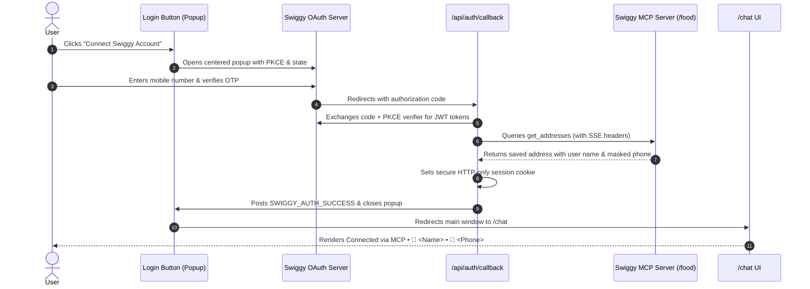

# Swiggy MCP Chatbot

An AI-powered conversational food assistant for Swiggy built with **Next.js 16 (App Router)**, **Model Context Protocol (MCP)**, and secure **OAuth 2.1 with PKCE**.

---

## Features

- **OAuth 2.1 with PKCE**: Secure authentication flow with Swiggy MCP authorization servers using cryptographically generated `code_verifier`, SHA-256 `code_challenge`, and CSRF `state`.
- **Seamless Popup Dialog**: Authentication opens in a centered popup window (`window.open`), keeping user context intact on the main screen, then auto-closes and redirects to `/chat` upon completion.
- **Dynamic User Profile & Contact Resolution**:
  - Automatically queries Swiggy's MCP server (`get_addresses`) upon login.
  - Extracts the verified account name (e.g., `Chirag Bhundiya`) and masked contact number (e.g., `+91 •••• ••0900`).
  - Supports optional pre-login phone binding passed as `login_hint` to Swiggy.
- **Header Profile Display**:
  - Clean, read-only display in the chat navigation bar:  
    `🟢 Connected via MCP • 👤 <User Name> • 📱 <Contact Number>`
- **Silent Auto Token Refresh**:
  - Automatically detects expired access tokens and refreshes them using the `refresh_token`.
  - Automatically purges cookies and redirects to login if the refresh token expires or is revoked.
- **Edge-to-Edge Responsive Chat Interface**:
  - Full-width, modern conversational interface.
  - Interactive quick suggestion pills for common Swiggy actions (Track Order, Past Orders, Search Food).
  - Rich interactive order status cards.
- **Direct Swiggy MCP Server Integration**:
  - Communicates directly with Swiggy's MCP Food endpoint (`https://mcp.swiggy.com/food`) via JSON-RPC 2.0 with `application/json, text/event-stream` protocols.

---

## Project Structure

```text
swiggy-mcp-chatbot/
├── src/
│   ├── app/
│   │   ├── page.tsx                      # Landing page with Swiggy connect button & auto-redirect
│   │   ├── layout.tsx                    # Root HTML layout with system typography
│   │   ├── globals.css                   # Tailwind CSS styling
│   │   ├── chat/
│   │   │   └── page.tsx                  # Protected chat page with dynamic MCP profile resolver
│   │   ├── auth/
│   │   │   └── callback/
│   │   │       ├── page.tsx              # Callback status UI for popup dialog
│   │   │       └── CallbackClientHandler.tsx # Notifies parent window via postMessage & closes popup
│   │   ├── callback/
│   │   │   └── route.ts                  # Route alias forwarding to /api/auth/callback
│   │   └── api/
│   │       ├── auth/
│   │       │   ├── login/
│   │       │   │   └── route.ts          # Initiates PKCE flow & sets temp cookies
│   │       │   ├── callback/
│   │       │   │   └── route.ts          # Exchanges code for tokens, resolves profile, sets session
│   │       │   ├── logout/
│   │       │   │   └── route.ts          # Clears session cookies & redirects to home
│   │       │   └── profile/
│   │       │       └── route.ts          # Profile endpoint to fetch/update session user data
│   │       └── chat/
│   │           └── route.ts              # Chat API endpoint orchestrating LLM & Swiggy MCP tools
│   │
│   ├── components/
│   │   ├── LoginButton.tsx               # Centered popup sign-in button with optional phone prefill
│   │   ├── ChatWindow.tsx                # Main full-width chat UI with MCP status header
│   │   ├── ChatMessage.tsx               # Render assistant/user bubbles and order cards
│   │   ├── ChatInput.tsx                 # Full-width message input with Enter-to-send
│   │   └── OrderStatusCard.tsx           # Swiggy live delivery tracking card
│   │
│   └── lib/
│       ├── oauth.ts                      # OAuth 2.1 PKCE generator, authorize URL builder & token exchange
│       ├── auth.ts                       # Session cookies, JWT parser, phone sanitizer, & MCP profile resolver
│       ├── token-manager.ts              # Token expiration check, auto-refresh, & logout management
│       ├── swiggy-mcp.ts                 # Swiggy MCP tool caller, tool schemas, & fallbacks
│       └── ai-agent.ts                   # LLM intent processor & Swiggy tool execution coordinator
│
├── .env.example                          # Environment variable template
├── package.json                          # Dependencies & build scripts
├── tsconfig.json                         # TypeScript configuration with @/* path alias
└── README.md                             # Documentation
```

---

## Environment Configuration

Create a `.env` or `.env.local` file from `.env.example`:

```bash
cp .env.example .env.local
```

Populate the required environment variables:

```env
# Swiggy OAuth 2.1 Credentials
SWIGGY_CLIENT_ID=your_client_id
SWIGGY_CLIENT_SECRET=your_client_secret_if_required
SWIGGY_REDIRECT_URI=http://localhost:3000/api/auth/callback

# Swiggy MCP Server URL
SWIGGY_MCP_SERVER_URL=https://mcp.swiggy.com/food

# OAuth Endpoints (Default values shown)
SWIGGY_AUTH_URL=https://mcp.swiggy.com/auth/authorize
SWIGGY_TOKEN_URL=https://mcp.swiggy.com/auth/token
```

---

## Authentication & Profile Resolution Flow



---

## Available Swiggy MCP Tools

The assistant coordinates calls to the following tools:

| Tool Name | Description |
|---|---|
| `get_addresses` | Retrieves saved delivery addresses and resolves user account details. |
| `get_active_orders` | Fetches active live orders currently placed by the user. |
| `track_order` | Returns real-time delivery status, ETA, and delivery partner information. |
| `get_order_history` | Retrieves past completed orders with item lists and totals. |
| `search_food` | Searches dishes, cuisines, and restaurants available on Swiggy. |

---

## Getting Started

1. **Install dependencies**:
   ```bash
   npm install
   ```

2. **Verify type check & lint**:
   ```bash
   npm run lint
   npx tsc --noEmit
   ```

3. **Run development server**:
   ```bash
   npm run dev
   ```

4. **Open in browser**:
   Navigate to [http://localhost:3000](http://localhost:3000).
