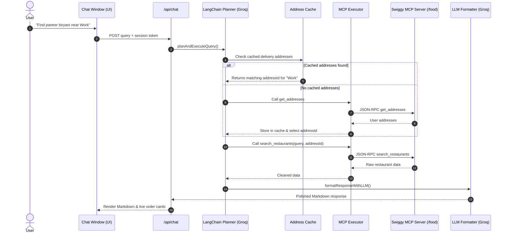

# Swiggy MCP Chatbot

An AI-powered conversational food assistant for Swiggy built with **Next.js 16 (App Router)**, **Model Context Protocol (MCP)**, **LangChain & Groq**, and secure **OAuth 2.1 with PKCE**.

---

## Features

- **Autonomous Agent Architecture (Planner ➔ Executor ➔ Formatter)**:
  - **Planner (`planner.ts`)**: Uses ChatGroq (`@langchain/groq`) to analyze user intent, reason over context, and plan tool calls with Zod schema validation.
  - **Smart Address Cache & Semantic Matching (`address-cache.ts`)**: Caches user addresses in-session and semantically matches location labels (e.g., "Home", "Work", "Office", or defaults) to avoid redundant MCP queries.
  - **Executor (`executor.ts`)**: Securely executes Swiggy MCP JSON-RPC 2.0 endpoints using the user's OAuth access token.
  - **Formatter (`formatter.ts`)**: LLM-driven response formatter that converts raw tool outputs into structured, appetizing Markdown with tables, emojis, ratings, and delivery times.
- **OAuth 2.1 with PKCE**: Secure authentication flow with Swiggy MCP authorization servers using cryptographically generated `code_verifier`, SHA-256 `code_challenge`, and CSRF `state`.
- **Seamless Popup Dialog**: Authentication opens in a centered popup window (`window.open`), keeping user context intact on the main screen, then auto-closes and redirects to `/chat` upon completion.
- **Dynamic User Profile & Contact Resolution**:
  - Automatically queries Swiggy's MCP server (`get_addresses`) upon login.
  - Extracts the verified account name and masked contact number (e.g., `+91 •••• ••0900`).
  - Supports optional pre-login phone binding passed as `login_hint` to Swiggy.
- **Modern Responsive Chat Interface**:
  - **Interactive Empty State (`ChatEmptyState.tsx`)**: Dynamic greeting with the user's name and cycling question suggestions that smoothly fade every 2.4 seconds.
  - **Minimalist Typing Indicator**: Clean, border-less bubble with bouncing orange loading dots.
  - **Progressive Blur & Under-Scroll Gradient**: Sleek frosted backdrop blur over chats scrolling under the floating input.
  - **Floating Scroll-To-Bottom Button**: Appears when scrolled up, allowing quick navigation to the latest messages.
  - **Rich Markdown (`ChatMessage.tsx`)**: Full GFM markdown support via `react-markdown` and `remark-gfm` with styled tables, badges, headers, and order cards.
- **Silent Auto Token Refresh**:
  - Automatically detects expired access tokens and refreshes them using the `refresh_token`.
  - Automatically purges cookies and redirects to login if the refresh token expires or is revoked.
- **Next.js 16.4.6**: Upgraded to the secure release with Turbopack and experimental security agent upgrades.

---

## Agent Architecture Flow



---

## Project Structure

```text
swiggy-mcp-chatbot/
├── src/
│   ├── app/
│   │   ├── page.tsx                      # Landing page with Swiggy connect button & auto-redirect
│   │   ├── layout.tsx                    # Root HTML layout with system typography
│   │   ├── globals.css                   # Tailwind CSS styling
│   │   ├── chat/
│   │   │   └── page.tsx                  # Protected chat page with dynamic MCP profile resolver
│   │   ├── auth/
│   │   │   └── callback/
│   │   │       ├── page.tsx              # Callback status UI for popup dialog
│   │   │       └── CallbackClientHandler.tsx # Notifies parent window via postMessage & closes popup
│   │   ├── callback/
│   │   │   └── route.ts                  # Route alias forwarding to /api/auth/callback
│   │   └── api/
│   │       ├── auth/
│   │       │   ├── login/
│   │       │   │   └── route.ts          # Initiates PKCE flow & sets temp cookies
│   │       │   ├── callback/
│   │       │   │   └── route.ts          # Exchanges code for tokens, resolves profile, sets session
│   │       │   ├── logout/
│   │       │   │   └── route.ts          # Clears session cookies & redirects to home
│   │       │   └── profile/
│   │       │       └── route.ts          # Profile endpoint to fetch/update session user data
│   │       └── chat/
│   │           └── route.ts              # Chat API endpoint orchestrating LLM & Swiggy MCP tools
│   │
│   ├── components/
│   │   ├── LoginButton.tsx               # Centered popup sign-in button with optional phone prefill
│   │   ├── ChatWindow.tsx                # Main full-width chat UI with floating controls & loading dots
│   │   ├── ChatEmptyState.tsx            # Animated greeting & cycling question suggestions
│   │   ├── ChatMessage.tsx               # Markdown renderer (tables, cards, badges) & avatars
│   │   ├── ChatInput.tsx                 # Full-width message input with Enter-to-send
│   │   └── OrderStatusCard.tsx           # Swiggy live delivery tracking card
│   │
│   └── lib/
│       ├── ai-agent.ts                   # Agent entry point delegating to planner
│       ├── planner.ts                    # LangChain Planner orchestrating multi-step MCP execution
│       ├── registry.ts                   # Declarative Swiggy MCP tool catalog with Zod schemas
│       ├── executor.ts                   # Direct MCP API caller & data cleaner
│       ├── formatter.ts                  # LLM response formatter transforming data into Markdown
│       ├── address-cache.ts              # In-session address caching & semantic location matching
│       ├── oauth.ts                      # OAuth 2.1 PKCE generator, authorize URL builder & token exchange
│       ├── auth.ts                       # Session cookies, JWT parser, phone sanitizer & profile resolver
│       ├── token-manager.ts              # Token expiration check, auto-refresh & logout management
│       └── swiggy-mcp.ts                 # Legacy Swiggy MCP client types & interfaces
│
├── .env.example                          # Environment variable template
├── next.config.ts                        # Next.js 16 configuration with Turbopack & agentUpgrade
├── package.json                          # Dependencies & build scripts (Next.js 16.4.6, LangChain, Groq)
├── tsconfig.json                         # TypeScript configuration with @/* path alias
└── README.md                             # Documentation
```

---

## Environment Configuration

Create a `.env` or `.env.local` file from `.env.example`:

```bash
cp .env.example .env.local
```

Populate the required environment variables:

```env
# Swiggy OAuth 2.1 Credentials
SWIGGY_CLIENT_ID=your_client_id
SWIGGY_CLIENT_SECRET=your_client_secret_if_required
SWIGGY_REDIRECT_URI=http://localhost:3000/api/auth/callback

# Swiggy MCP Server URL
SWIGGY_MCP_SERVER_URL=https://mcp.swiggy.com/food

# OAuth Endpoints (Default values shown)
SWIGGY_AUTH_URL=https://mcp.swiggy.com/auth/authorize
SWIGGY_TOKEN_URL=https://mcp.swiggy.com/auth/token

# Groq LLM Configuration (Planner & Formatter)
GROQ_API_KEY=your_groq_api_key
GROQ_MODEL=openai/gpt-oss-120b
```

---

## Available Swiggy MCP Tools

The assistant coordinates calls to the following tools:

| Tool Name | Parameters | Description |
|---|---|---|
| `get_addresses` | *None* | Fetches all saved delivery addresses for the logged-in user and extracts location labels. |
| `search_restaurants` | `query`, `addressId` | Searches restaurants, dishes, and cuisines near a specific delivery address. |
| `get_active_orders` | *None* | Fetches active live orders currently placed by the user. |
| `track_order` | `orderId` | Returns real-time delivery status, ETA, and delivery partner information. |
| `get_order_history` | *None* | Retrieves past completed orders with item lists and totals. |

---

## Getting Started

1. **Install dependencies**:
   ```bash
   npm install
   ```

2. **Verify type check & lint**:
   ```bash
   npm run lint
   npx tsc --noEmit
   ```

3. **Run development server**:
   ```bash
   npm run dev
   ```

4. **Open in browser**:
   Navigate to [http://localhost:3000](http://localhost:3000).
